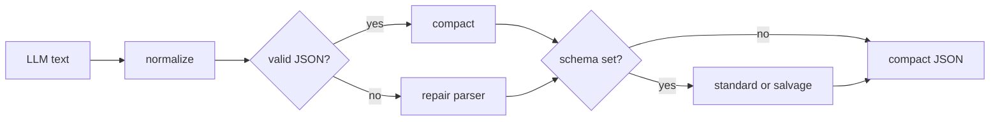

# json-repair

[English](README.md) · [中文](README.zh.md)

Repair malformed JSON from LLM output into compact, valid JSON.

[](https://github.com/RealAlexandreAI/json-repair/actions/workflows/ci.yaml)
[](https://github.com/RealAlexandreAI/json-repair/blob/main/LICENSE)
[](go.mod)
[](https://github.com/RealAlexandreAI/json-repair/releases)


A Go library and a small CLI. The module is `github.com/RealAlexandreAI/json-repair`, Go 1.21, with no third-party dependencies. It is a Go port of [json_repair](https://github.com/mangiucugna/json_repair). Latest tagged release: [v0.0.18](https://github.com/RealAlexandreAI/json-repair/releases/tag/v0.0.18).

`RepairJSON` and `MustRepairJSON` always return a compact JSON string. `RepairWithOptions` is the entry point when you need the parsed value, a repair log, strict mode, stream-stable partial strings, or schema-guided repair.

## How a call runs



`normalize` strips ` ```json ` fences, `//`, `/* */`, and `#` comments, and maps full-width brackets, colons, commas, and semicolons to ASCII. Quote variants are recognized by the parser, not rewritten in a blanket pass. Already-valid JSON is compacted and returned; the parser runs only when the input is not valid JSON, or when `SkipJSONValidation` is set.

## Install

Library:

```shell
go get github.com/RealAlexandreAI/json-repair
```

CLI, from this repository's Homebrew formula:

```shell
brew install RealAlexandreAI/json-repair/jsonrepair
```

Or download a release archive from [Releases](https://github.com/RealAlexandreAI/json-repair/releases). GoReleaser builds `jsonrepair` for linux, darwin, and windows (`CGO_ENABLED=0`). The binary name is `jsonrepair`.

## Library

```go
package main

import "github.com/RealAlexandreAI/json-repair"

func main() {
    in := "```json {'employees':['John', 'Anna', ```"

    out, err := jsonrepair.RepairJSON(in)
    // out: {"employees":["John","Anna"]}
    _ = out
    _ = err

    // MustRepairJSON returns "" when repair fails.
    _ = jsonrepair.MustRepairJSON(in)
}
```

More cases are in [`jsonrepair_test.go`](jsonrepair_test.go). Object key order in the output follows Go's `encoding/json` map encoding, so it is not stable across keys.

### Functions

| Function | Signature | Returns |
| --- | --- | --- |
| `RepairJSON` | `(src string) (string, error)` | Compact repaired JSON. |
| `MustRepairJSON` | `(src string) string` | Same JSON, or `""` on error. Used by the CLI. |
| `RepairValue` | `(src string) (any, error)` | Parsed Go value only. |
| `RepairWithOptions` | `(src string, options RepairOptions) (RepairResult, error)` | `Value`, compact `JSON`, and `Log`. |
| `RepairReader` | `(reader io.Reader, options RepairOptions) (RepairResult, error)` | Reads the whole reader, then repairs. |
| `RepairFile` | `(filename string, options RepairOptions) (RepairResult, error)` | Reads the file. Does not write it back. |
| `RepairJSONWithSchema` | `(src string, schema map[string]any) (string, error)` | Schema repair in standard mode. |
| `NewJSONParser` | `(in string) *JSONParser` | Parser with default options. |

`RepairResult` fields: `Value any`, `JSON string`, `Log []RepairLogEntry`. Each log entry has `Text` and `Context`. `Log` is nil unless `Logging` is true; for valid JSON it is an empty non-nil slice.

A panic inside repair is recovered and returned as `repair json panic: ...`. `Schema` and `Strict` together return an error. `SchemaRepairMode` `"salvage"` without a schema returns an error.

### RepairOptions

The zero value is the normal repair path.

| Field | Type | Effect |
| --- | --- | --- |
| `SkipJSONValidation` | `bool` | Skip the valid-JSON fast path and always run the parser. |
| `Logging` | `bool` | Fill `RepairResult.Log`. |
| `StreamStable` | `bool` | Keep an unfinished string closed, instead of letting the default parser reinterpret the tail. |
| `Strict` | `bool` | Reject duplicate keys, a missing `:`, an empty key or value, and more than one top-level value. |
| `Schema` | `any` | JSON Schema object (`map[string]any`) or a boolean schema. |
| `SchemaRepairMode` | `SchemaRepairMode` | `""` and `"standard"` are standard. `"salvage"` drops invalid array items and can recover a schema-matching top-level fragment. |

```go
result, err := jsonrepair.RepairWithOptions(`{"key": }`, jsonrepair.RepairOptions{
    Logging: true,
})
// result.Value  parsed Go value
// result.JSON   compact JSON
// result.Log    repair actions
```

Schema-guided repair accepts object, array, and scalar schemas, plus `required`, `default`, `enum`, `const`, `items`, `additionalItems`, `patternProperties`, `additionalProperties`, `anyOf`, `oneOf`, `allOf`, and local `$ref` (`#/...` only). A string whose schema type is object or array is parsed again as nested JSON. Salvage mode can drop an array item that fails the item schema; standard mode returns that error.

```go
schema := map[string]any{
    "type": "array",
    "items": map[string]any{"type": "integer"},
}
out, err := jsonrepair.RepairWithOptions(`[1,"bad",2]`, jsonrepair.RepairOptions{
    Schema:           schema,
    SchemaRepairMode: jsonrepair.SchemaRepairSalvage,
})
// out.JSON: [1,2]
_, _ = out, err
```

Python Pydantic models and Python `json.dumps` keyword arguments are not part of this API. Unicode in string values is preserved.

## What it repairs

Outputs below are the compact JSON from `RepairJSON` on the current tests. Where the parser rebuilds an object, key order can differ from the input; the table shows the logical repair.

| Input | Output |
| --- | --- |
| `{'key': 'string', 'key2': false, "key3": null, "key4": unquoted}` | `{"key":"string","key2":false,"key3":null,"key4":"unquoted"}` |
| `{"key": TRUE, "key2": FALSE, "key3": Null` | `{"key":true,"key2":false,"key3":null}` |
| `{"none": None, "prefix": TrueBlue, "valid": True}` | `None` becomes `null`, `True` becomes `true`, `TrueBlue` stays a string |
| `[1, 2, 3, 4` | `[1,2,3,4]` |
| `{"employees":["John", "Anna",` | `{"employees":["John","Anna"]}` |
| `[` | `[]` |
| `]` | `""` |
| `[[1` plus a blank line plus `]` | `[[1]]` |
| `{foo: [}` | `{"foo":[]}` |
| `{"value_1": true, COMMENT "value_2": "data"}` | `{"value_1":true,"value_2":"data"}` |
| ` - { "test_key": ["test_value", "test_value2"] }` | object with that array |
| `{ "content": "[LINK]("https://google.com")" }` | link text kept, inner quotes escaped |
| `{"key":"",}` | `{"key":""}` |
| `` ```json { ... } ``` `` | fence removed, object repaired |
| `(1, 2, True)` | `[1,2,true]` |
| `{"key":"value"}[1,2,3,true]` | `[{...},[1,2,3,true]]` |
| `{“key”: “value”}` and `｛＂key＂：＂value＂｝` | `{"key":"value"}` |

Also covered: unclosed strings, missing commas, leading or trailing non-JSON text, hash and block comments, duplicate keys, and a code fence wrapped around the JSON. Comma-separated duplicate keys in otherwise valid JSON are left in the compact string; `RepairResult.Value` keeps the later value. The parser itself, used when the input is not valid JSON or `SkipJSONValidation` is set, overwrites a comma-separated duplicate and emits one key. A duplicate key with no comma between it and the previous value is not split into a second object: `{"a":1 "a":2}` becomes `[{"a":1},"a",2]`.

## CLI

```text
Usage: jsonrepair <options>
Options:
	-f 	 File path (Default )
	-h 	 Print help (Default false)
	-i 	 String input inline (Default )
	-v 	 Print version details (Default false)
```

```shell
jsonrepair -i "{'employees':['John', 'Anna', "
# {"employees":["John","Anna"]}

jsonrepair -f input.json
jsonrepair -v
```

`-i` wins over `-f` when both are set and `-i` is non-empty. A missing file prints `[json-repair] invalid file path: ...` and does not exit non-zero. With no `-i` and no `-f`, the command prints nothing. `-v` prints `Version: ` plus the ldflags value, or `Version: dev` when unset. There is no stdin pipe mode.

## License

[GNU General Public License v3.0](LICENSE).

Upstream Python project: [mangiucugna/json_repair](https://github.com/mangiucugna/json_repair).
