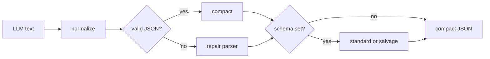

# json-repair

[English](README.md) · [中文](README.zh.md)

把 LLM 输出的畸形 JSON 修成紧凑、合法的 JSON。

[](https://github.com/RealAlexandreAI/json-repair/actions/workflows/ci.yaml)
[](https://github.com/RealAlexandreAI/json-repair/blob/main/LICENSE)
[](go.mod)
[](https://github.com/RealAlexandreAI/json-repair/releases)


Go 库，附带一个小 CLI。模块路径是 `github.com/RealAlexandreAI/json-repair`，Go 1.21，没有第三方依赖。它是 [json_repair](https://github.com/mangiucugna/json_repair) 的 Go 移植。最新 tag：[v0.0.18](https://github.com/RealAlexandreAI/json-repair/releases/tag/v0.0.18)。

`RepairJSON` 和 `MustRepairJSON` 返回紧凑 JSON 字符串。需要解析后的值、修复日志、严格模式、流式未完成字符串，或按 schema 修复时，用 `RepairWithOptions`。

## 一次调用怎么走



`normalize` 去掉 ` ```json ` 代码围栏、`//`、`/* */` 和 `#` 注释，并把全角括号、冒号、逗号、分号换成 ASCII。引号变体由解析器识别，不做整段替换。已经合法的 JSON 只做紧凑化后返回；只有输入不是合法 JSON，或设置了 `SkipJSONValidation` 时，才会走解析器。

## 安装

库：

```shell
go get github.com/RealAlexandreAI/json-repair
```

CLI，来自 [Homebrew tap](https://github.com/RealAlexandreAI/homebrew-tap-jsonrepair)：

```shell
brew install realalexandreai/tap-jsonrepair/jsonrepair
```

也可以从 [Releases](https://github.com/RealAlexandreAI/json-repair/releases) 下载发布包。GoReleaser 为 linux、darwin、windows 构建 `jsonrepair`（`CGO_ENABLED=0`）。二进制名是 `jsonrepair`。

## 库

```go
package main

import "github.com/RealAlexandreAI/json-repair"

func main() {
    in := "```json {'employees':['John', 'Anna', ```"

    out, err := jsonrepair.RepairJSON(in)
    // out: {"employees":["John","Anna"]}
    _ = out
    _ = err

    // 修复失败时 MustRepairJSON 返回 ""。
    _ = jsonrepair.MustRepairJSON(in)
}
```

更多用例在 [`jsonrepair_test.go`](jsonrepair_test.go)。对象键的输出顺序跟随 Go `encoding/json` 的 map 编码，跨键不稳定。

### 函数

| 函数 | 签名 | 返回 |
| --- | --- | --- |
| `RepairJSON` | `(src string) (string, error)` | 紧凑的修复结果。 |
| `MustRepairJSON` | `(src string) string` | 同样的 JSON；出错时返回 `""`。CLI 用这个。 |
| `RepairValue` | `(src string) (any, error)` | 只返回解析后的 Go 值。 |
| `RepairWithOptions` | `(src string, options RepairOptions) (RepairResult, error)` | `Value`、紧凑 `JSON`、`Log`。 |
| `RepairReader` | `(reader io.Reader, options RepairOptions) (RepairResult, error)` | 读完整个 reader 再修复。 |
| `RepairFile` | `(filename string, options RepairOptions) (RepairResult, error)` | 读文件。不写回磁盘。 |
| `RepairJSONWithSchema` | `(src string, schema map[string]any) (string, error)` | 标准模式的 schema 修复。 |
| `NewJSONParser` | `(in string) *JSONParser` | 默认选项的解析器。 |

`RepairResult` 字段：`Value any`、`JSON string`、`Log []RepairLogEntry`。每条日志有 `Text` 和 `Context`。只有 `Logging` 为 true 时 `Log` 才非 nil；输入已是合法 JSON 时，它是空的非 nil 切片。

修复过程中的 panic 会被恢复，并作为 `repair json panic: ...` 返回。`Schema` 和 `Strict` 不能同时使用。`SchemaRepairMode` 为 `"salvage"` 但没有 schema 时返回错误。

### RepairOptions

零值就是普通修复路径。

| 字段 | 类型 | 作用 |
| --- | --- | --- |
| `SkipJSONValidation` | `bool` | 跳过合法 JSON 快路径，始终走解析器。 |
| `Logging` | `bool` | 填充 `RepairResult.Log`。 |
| `StreamStable` | `bool` | 把未写完的字符串闭合，而不是让默认解析器重新解释尾部。 |
| `Strict` | `bool` | 拒绝重复键、缺少 `:`、空键或空值，以及多个顶层值。 |
| `Schema` | `any` | JSON Schema 对象（`map[string]any`）或布尔 schema。 |
| `SchemaRepairMode` | `SchemaRepairMode` | `""` 和 `"standard"` 是标准模式。`"salvage"` 丢弃不合法的数组元素，并可以找回符合 schema 的顶层片段。 |

```go
result, err := jsonrepair.RepairWithOptions(`{"key": }`, jsonrepair.RepairOptions{
    Logging: true,
})
// result.Value  解析后的 Go 值
// result.JSON   紧凑 JSON
// result.Log    修复动作
```

按 schema 修复支持 object、array、标量，以及 `required`、`default`、`enum`、`const`、`items`、`additionalItems`、`patternProperties`、`additionalProperties`、`anyOf`、`oneOf`、`allOf` 和本地 `$ref`（只支持 `#/...`）。schema 类型是 object 或 array 的字符串会再按嵌套 JSON 解析一次。salvage 模式可以丢掉不符合元素 schema 的数组项；标准模式返回这个错误。

```go
schema := map[string]any{
    "type": "array",
    "items": map[string]any{"type": "integer"},
}
out, err := jsonrepair.RepairWithOptions(`[1,"bad",2]`, jsonrepair.RepairOptions{
    Schema:           schema,
    SchemaRepairMode: jsonrepair.SchemaRepairSalvage,
})
// out.JSON: [1,2]
_, _ = out, err
```

Python 的 Pydantic 模型和 `json.dumps` 关键字参数不属于这个 API。字符串里的 Unicode 会保留。

## 能修什么

下表是当前测试里 `RepairJSON` 的紧凑 JSON。解析器重建对象时，键序可能和输入不同；表里写的是修复结果本身。

| 输入 | 输出 |
| --- | --- |
| `{'key': 'string', 'key2': false, "key3": null, "key4": unquoted}` | `{"key":"string","key2":false,"key3":null,"key4":"unquoted"}` |
| `{"key": TRUE, "key2": FALSE, "key3": Null` | `{"key":true,"key2":false,"key3":null}` |
| `{"none": None, "prefix": TrueBlue, "valid": True}` | `None` 变成 `null`，`True` 变成 `true`，`TrueBlue` 仍是字符串 |
| `[1, 2, 3, 4` | `[1,2,3,4]` |
| `{"employees":["John", "Anna",` | `{"employees":["John","Anna"]}` |
| `[` | `[]` |
| `]` | `""` |
| `[[1` 加空行再加 `]` | `[[1]]` |
| `{foo: [}` | `{"foo":[]}` |
| `{"value_1": true, COMMENT "value_2": "data"}` | `{"value_1":true,"value_2":"data"}` |
| ` - { "test_key": ["test_value", "test_value2"] }` | 含该数组的对象 |
| `{ "content": "[LINK]("https://google.com")" }` | 链接文本保留，内部引号转义 |
| `{"key":"",}` | `{"key":""}` |
| `` ```json { ... } ``` `` | 去掉围栏，修复对象 |
| `(1, 2, True)` | `[1,2,true]` |
| `{"key":"value"}[1,2,3,true]` | `[{...},[1,2,3,true]]` |
| `{“key”: “value”}` 和 `｛＂key＂：＂value＂｝` | `{"key":"value"}` |

另外覆盖：未闭合字符串、缺逗号、前后多余的非 JSON 文本、井号注释和块注释、重复键，以及包在 JSON 外面的代码围栏。其余部分已经合法的 JSON 里，用逗号分隔的重复键会原样留在紧凑字符串中；`RepairResult.Value` 保留后写的值。输入不是合法 JSON，或设置了 `SkipJSONValidation` 时走解析器，逗号分隔的重复键会被覆盖，只输出一个键。重复键和前一个值之间没有逗号时，不会拆成第二个对象：`{"a":1 "a":2}` 变成 `[{"a":1},"a",2]`。

## CLI

```text
Usage: jsonrepair <options>
Options:
	-f 	 File path (Default )
	-h 	 Print help (Default false)
	-i 	 String input inline (Default )
	-v 	 Print version details (Default false)
```

```shell
jsonrepair -i "{'employees':['John', 'Anna', "
# {"employees":["John","Anna"]}

jsonrepair -f input.json
jsonrepair -v
```

`-i` 和 `-f` 同时给出且 `-i` 非空时，用 `-i`。文件不存在时打印 `[json-repair] invalid file path: ...`，退出码仍是 0。没有 `-i` 也没有 `-f` 时不打印内容。`-v` 打印 `Version: ` 加 ldflags 注入的版本；未注入时是 `Version: dev`。没有 stdin 管道模式。

## 许可证

[GNU General Public License v3.0](LICENSE)。

上游 Python 项目：[mangiucugna/json_repair](https://github.com/mangiucugna/json_repair)。
